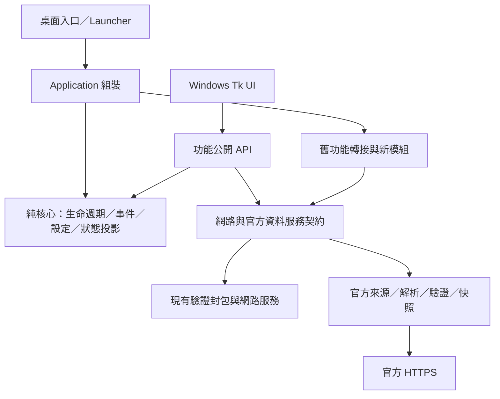

# LaLa 主程式重建架構

本工程採「全新架構、逐步移植既有功能」，目前程式版本仍為 **0.6.1**。本文件區分已存在的程式、設計目標及尚未驗收項目；沒有將 PR #57 的拆檔視為新核心完成。

## P0 基準與來源

- 基準 main：`2dd6694b46e22e6e0102195036a859e3720a083c`，2026-10-26 取得。
- PR [#57](https://github.com/blesses0603/WLRe_lala/pull/57) 已於 2026-10-26T13:25:02Z 合併；頭提交 `967e6f6` 已包含於 main。保留原 PR、提交與 Windows 修復，不另行合併或改寫它。
- 已驗證歷史提交 `cb9e9a77` 是此 main 的祖先。最新 main 三平台 CI：[40330390002](https://github.com/blesses0603/WLRe_lala/actions/runs/40330390002)，三個測試工作均成功。
- 獨立分支：`feature/lala-core-rebuild`，建立前不存在，從上述 main 建立；沒有更動 main。
- 讀取 README、版本檔、`版本歷史.md`、專案依賴、CI、`docs/MODULARIZATION_PLAN.md`。全部受版本控制 Python 檔案以 AST 逐檔分析：**438 檔／52,792 行**，其中執行程式 240、工具 28、測試 169、桌面入口 1。
- [完整符號／依賴／資源／測試匯入清單](docs/rebuild/main_inventory.json)、[逐檔新舊責任對照](docs/rebuild/FILE_MAPPING.md)。盤點不執行受分析來源，動態匯入與靜態分析限制明列於輸出。

## 現況

桌面入口 `WLRE_Client.py` 負責打包啟動、自我檢查與錯誤回報；`wlre.launcher` 為原始碼環境啟動器。`ui.gui.App` 組裝登入、主頁與功能視窗，仍持有會話背景執行緒、命令佇列、Tk 計時器及顯示快照。`network.client.run_client` 擁有 socket、封包處理及服務 tick。`core.state.State` 是網路執行緒單一寫入的權威即時狀態。`SessionBridge`、`DisplayQueue` 將副本交給 UI，不能改成由 UI 寫入同一 State。

既有 `core` 並非純核心：State 初始化／事件 reducer 依賴服務；服務亦建立封包。官方 Runtime 仍固定 1275，部分物品、地圖圖像、座標與副本參考依賴歷史本機資源。這些不是新架構的模組契約，也不能刪掉檔案就解決。

AST 找到兩組強連通分量：協力／副本 UI 相容入口 3 檔，以及資源／物品／Runtime 延遲載入 26 檔。逐檔清單保留完整成員。它們包含函式內匯入，不能直接宣稱啟動必然循環失敗；新核心禁止依賴這些群組，以明確轉接界面分批處理。

## 目標依賴方向

核心只使用 Python 標準庫，不匯入 Tk、ctypes、Pillow、UnityPy 或 Windows API。Android 日後可組裝相同核心；本工程不修改 Android Repository。功能模組與 UI 經公開介面或型別事件互動；網路 State 仍由原擁有者更新，核心投影不成為第二份可寫遊戲狀態。

新核心優先置於 `wlre/core/application` 與 `wlre/core/events`，避開既有 `core/state.py` 的同名衝突。新功能按實際移植建立 `wlre/modules/<功能>`，官方管線放 `wlre/resources_runtime`，避免把 Python 套件與現有 `wlre/resources` 遊戲資產目錄混淆。不先建立空模組。

P1a 已建立上述純核心、`core/primitives.py` 與回歸測試。P1b 由 `ui/application_host.py` 的過渡 DesktopModule 接入既有 App，正常入口與 GUI smoke 均使用新 Host；業務仍由舊功能提供，尚未完成逐功能移植。`StateManager` 是不可變投影，絕不將舊 `State` 直接分享給新模組。可執行 API 在 READY／RUNNING 才開放，停止先封鎖所有 API，之後依反向相依順序清理。詳細公開介面見 [模組契約](MODULES.md)。

## 執行緒與關閉契約

核心生命週期及同步事件分派由組裝執行緒擁有。跨執行緒通知採有界 mailbox，擁有者定量 drain；不將既有 socket 迴圈改成 async，也不在事件 handler 內下載資源。UI adapter 決定 Tk `after` 排程。停止依反向相依順序執行，釋放訂閱、計時器與工作；停止失敗必須報告，不得標示正常關閉。

先建立可測試生命週期與事件契約，再將現有桌面作為明確的過渡 adapter 接入。此 adapter 表示功能仍由舊實作提供，**不是全功能移植完成**。停止背景網路工作、逾時及 UI 回應性需另有整合測試。

## P0 關卡判定

來源完整、版本／PR 狀態可核對、既有測試已建立、官方 Manifest 可取得，重要相依已有來源路徑。舊循環與固定版本屬明確隔離的遷移工作，沒有要求新核心先依賴它們。P0 報告提交後允許開始 P1；不表示官方資料管線、封包、地圖或全功能驗收通過。詳見 [移植計畫](MIGRATION_PLAN.md)、[測試紀錄](TESTING.md)。
