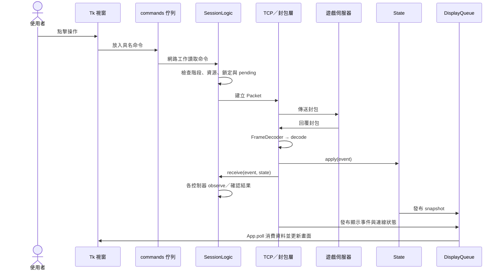
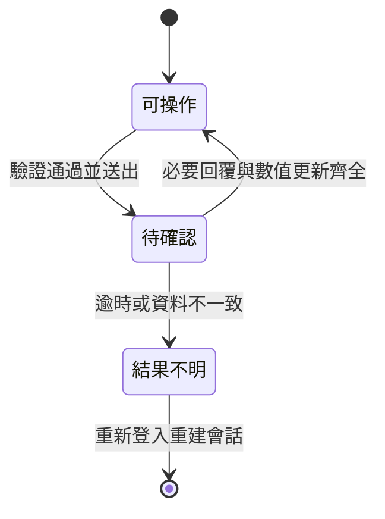

# WLRe:LaLa 整體架構

本文件以 `main` 的 `7657b04` 為基礎，包含本次分支的架構整理與改善。應用程式版本為 `0.5.0`，遊戲資料與協定核對版本為 `1262`。第 12 節列出已落實的調整與後續界線。

- [完整目錄與模組索引](STRUCTURE.md)
- [介面配置](UI_LAYOUT.md)
- [封包與協定](PROTOCOLS.md)
- [建置與發佈](NUITKA_BUILD.md)

## 1. 專案定位與組成

這是 Python 桌面程式，使用 Tkinter／ttk 建立介面、Pillow 處理圖像，透過 TCP 與遊戲伺服器交換封包。除了桌面介面，也提供地圖、導航與連線研究用的命令列入口。沒有獨立 Web 後端或資料庫服務；設定主要存為本機 JSON，圖像與官方資料隨程式打包。

```text
WLRE_Client.py          桌面／Nuitka 直接入口
run_client.*           原始碼啟動腳本
wlre/
  launcher.py          檢查圖像依賴，必要時準備 .ui-env
  __main__.py          命令列入口
  paths.py             內建資源絕對位置
  ui/                  視窗、控制項、畫面模型與顯示佇列
  network/             TCP、框架編解碼、封包轉事件、連線排程
  core/                會話狀態、統計、事件文字、診斷與快取維護
  services/
    battle/            戰鬥規則、角色配點、夥伴與隊伍
    world/             座標、導航、移動、傳點、徘徊
    items/             物品知識、補給、製作、煉金、倉庫、戰後維護
    social/            聊天、名稱與公會
    expedition*.py     遠征狀態機、官方資料與組隊搜尋
  storage/             帳號設定、登入記憶、檔案鎖與原子寫入
  resources/           JSON、ZIP、介面貼圖與功能圖示
tools/                 編譯、發佈與資源維護工具
tests/                 unittest 自動化測試
docs/                  架構、協定、介面與實測限制
.github/workflows/     Windows／macOS 發版工作流程
```

這些是檔案責任分區，尚不是完全單向的分層架構：`State` 會呼叫服務的事件套用函式，服務也可能直接建立 `Packet`，部分服務使用 `core` 的物品更新工具。不能將 `core` 當成完全不依賴其他層的純核心。

## 2. 三種啟動入口

| 使用情境 | 入口與流程 | 責任 |
|---|---|---|
| Windows 原始碼執行 | `run_client.bat` → `python -m wlre.launcher` → `wlre.ui.gui` | 偵測 Python、準備必要依賴、開啟主程式 |
| macOS 原始碼執行 | `run_client.command` → 合適的 Python → `wlre.launcher` | 找到具有 Tk 支援的 Python，再啟動介面 |
| 打包程式 | `WLRE_Client.py` → `gui.main()` → `App` | 直接啟動，不建立子 Python 或臨時安裝依賴 |
| 導航工具 | `run_navigation.bat` → launcher `--navigation` | 開啟獨立導航視窗 |
| 命令列 | `python -m wlre` | 地圖座標、離線路徑與研究用連線命令 |

`wlre/__init__.py` 是應用版本來源。`wlre/paths.py` 以套件位置建立 `RESOURCE_ROOT`，避免從目前工作目錄猜測資源位置。

`WLRE_Client.py` 另外提供 `--self-test` 與 `--smoke-test-gui`：前者檢查依賴與部分資源，後者實際建立主視窗並處理 Tk 事件。它們不會登入遊戲。原始碼 launcher 的依賴準備，與打包程式的啟動流程不同。

## 3. 主要執行物件與資料所有權

| 物件 | 所在檔案 | 擁有或協調的內容 |
|---|---|---|
| `App` | `ui/gui.py` | 視窗、登入介面、工作執行緒、指令佇列、顯示佇列、最新畫面快照 |
| `SessionLogic` | `network/client.py` | 登入階段、指令驗證、事件回應，以及各自動功能控制器 |
| `State` | `core/state.py` | 一次連線的伺服器已知狀態、操作中狀態與統計 |
| `FrameDecoder`／`Packet`／`Reader`／`Writer` | `network/wire.py` | TCP 框架還原、封包資料結構與嚴格讀寫 |
| `StatePublisher` | `network/state_updates.py` | 合併畫面快照發布頻率，不延遲實際封包處理 |
| `DisplayQueue` | `ui/event_queue.py` | 從背景工作到 Tk 的有界顯示信箱 |
| 各功能控制器 | `services/` | 功能自己的等待、確認、逾時與續作條件 |

### 執行緒邊界

主要是 Tk 主執行緒與網路背景工作執行緒。主執行緒處理控制項與顯示；網路工作讀取指令、處理封包與服務排程。遠征介面另可使用單工作者的背景組隊計算，避免大量組合搜尋阻塞 Tk。

UI 透過 `App.send()` 將命令放進 `commands`，不直接操作 socket。網路端透過事件／狀態回呼將資料放進 `DisplayQueue`，再由 `App.poll()` 處理。`State.snapshot()` 使用 dataclass 的 `asdict()` 建立快照；修改畫面快照不等於修改連線中的權威狀態。

## 4. 指令與伺服器回覆的完整資料流



重要的順序是先 `State.apply(event)`，再由 `SessionLogic.receive()` 通知控制器。因此控制器檢查的是已套用這一筆回覆的狀態。

使用者指令遭拒絕時會產生 `command_rejected`，由 UI 顯示原因；指令放入佇列或 socket 送出成功，都不表示遊戲操作已成功。

## 5. 連線與排程協調

`run_client()` 在同一個網路工作迴圈中維護連線、處理命令與推進服務，不是每項自動功能各自開一條 TCP 連線。

目前一輪迴圈大致依序處理：

1. 連線健康發布、週期清理、角色配點逾時、待發布快照。
2. 待回應事件與指令佇列，每輪最多取 20 筆命令。
3. 戰後維護、遠征、製作、補給確認、自動戰鬥、煉金。
4. 徘徊、移動與傳點流程。
5. 接收 TCP 資料，拆框、解碼、套用狀態及回應事件。

這個先後順序不是功能可以任意同時改背包的保證。是否能進行下一步，仍由每個控制器的條件、物品保留與 `SessionLogic.command()` 的互斥檢查決定。

`ConnectionHealth` 使用 OS TCP keepalive 與實際收到資料的時間判斷連線狀態；安靜一段時間只代表待確認，不直接推定已登出。GUI 的 `ConnectionStatus` 與角色快照分開更新，避免舊角色畫面掩蓋斷線狀態。

## 6. State 與資料可信度

| 狀態群組 | 主要欄位 | 意義 |
|---|---|---|
| 連線與角色 | `phase`、`roles`、`player`、`initial_data_complete` | 登入／選角與角色位置 |
| 世界移動 | `positions`、`location`、`navigation`、`local_movement`、`portal_travel` | 位置證據、導航資料、移動要求與抵達確認 |
| 戰鬥 | `battle`、`battle_units`、`battle_count`、`auto_battle` | 回合、單位、已送指令及 AI 狀態 |
| 角色知識 | `knowledge`、`attribute_allocation` | 已確認能力、特技、裝備、夥伴與配點進度 |
| 物品 | `inventory`、`potion_storage`、`maintenance` | 實際背包、藥水儲存槽、戰後操作 |
| 小屋／生產 | `furniture`、`room_storage`、`crafting`、`alchemy` | 家具、儲藏室、雜物櫃、製作及煉金 |
| 遠征／社交 | `expedition`、`party`、`guild` | 任務、駐紮所夥伴、隊伍、公會 |
| 顯示與統計 | `efficiency`、`packet_count`、`unimplemented_count` | 經驗效率與處理計數 |

### 幾個不同的狀態不能混用

- `ready` 表示該類資料已收到初始化；不同模組使用的初始化旗標不一定同名。
- `reliable` 表示目前資料仍一致，不能只看背包有物品就推定可使用。
- `pending` 表示已送出操作、尚待確認。各模組資料型態不同，不能假設都是同一種結構。
- `uncertain` 表示結果不能確認。通常需要重新登入同步，不能當作失敗後直接重送。
- 「送出」、「回覆成功」、「物品扣除／數值更新」是不同階段，部分操作要多個證據齊全才完成。

`State.apply()` 會先將事件分派給補給、公會、活動、製作、倉庫、物品知識、配點、隊伍與遠征等事件套用函式，再更新其餘通用狀態及統計。這也是目前 `core` 與 `services` 有雙向責任往來的原因。

## 7. 功能模組對照

| 功能 | 主要介面 | 主要規則／狀態機 | 重要邊界 |
|---|---|---|---|
| 主頁與狀態摘要 | `overview_ui.py` | 各服務摘要與 `State` 快照 | 不把畫面摘要當作操作成功證據 |
| 自動戰鬥 | `auto_battle_ui.py`、`battle_view.py` | `battle/auto_battle.py`、`battle_commands.py` | 分回合決策，核對角色、目標、特技與資源 |
| HP／SP 補給 | `recovery_ui.py`、`resource_view.py` | `items/recovery.py`、`field_supply.py` | 等待扣料與同一對象數值更新 |
| 戰後修理／整理 | `maintenance_ui.py` | `items/maintenance.py`、`post_battle_maintenance.py` | 背包選物、逐筆確認、不得逾時重送 |
| 角色配點 | `attribute_points_ui.py` | `battle/attribute_points.py` | 比對伺服器基準，成功回覆與能力更新均確認 |
| 夥伴出戰 | `companion_ui.py` | `battle/companions.py` | 等待伺服器確認出戰狀態 |
| 組隊與必要隊員 | `services_ui.py`、`party_guard_ui.py` | `battle/party.py`、`party_guard.py` | 隊長／隊員限制與 AI 所需隊員檢查 |
| 遠征 | `expedition_ui.py`、`expedition_display.py` | `expedition.py`、`expedition_data.py`、`expedition_teams.py` | 官方資料、最高成功率組隊、補好友度與領獎確認 |
| 製作 | `crafting_ui.py`、`crafting_browser.py`、`crafting_plan_ui.py` | `items/crafting.py`、`crafting_plan.py`、`crafting_browser_model.py` | 設備、材料、伺服器排程與本機清單分開 |
| 煉金 | `services_ui.py` | `items/alchemy.py` | 結果、扣料與入包確認後才接續 |
| 背包與特技 | `resource_view.py`、`bag_grid.py` | `items/combat_resources.py` | 只呈現已同步物品與已確認特技；使用時再驗證 |
| 小屋儲藏室／雜物櫃 | `resource_view.py` 的超空間袋頁 | `items/room_storage.py` | 目前只有唯讀同步，不能當作自動取料來源 |
| 地圖與導航 | `home_map.py`、`minimap.py`、`navigation_gui.py` | `world/coordinates.py`、`navigation.py`、`movement.py`、`portal_travel.py`、`roaming.py` | 導航座標、封包座標與伺服器位置確認分開 |
| 聊天／公會 | `chat_ui.py`、`chat_emoji.py` | `social/chat.py`、`chat_names.py`、`guild.py` | 顯示事件與發話封包分開 |
| 經驗效率 | `efficiency_ui.py` | `core/efficiency.py` | 首場作基準；預估不是伺服器保證時間 |

### 背包與小屋資料的差別

一般背包以 `inventory` 為準；儲藏室／雜物櫃以 `room_storage` 為準。超空間袋頁目前只是將已驗證的 S62 伺服器資料顯示出來，沒有存入、領出或自動挪用倉庫物品的送出流程。

普通背包格狀介面採 6 欄 × 4 列，一頁 24 格；內嵌儲物頁採 6 欄 × 2 列，一頁 12 格。這是 UI 分頁容量，並不是背包或小屋的伺服器容量。

## 8. 資源保留與操作互斥

背包內的物品不應由兩個自動功能同時取用。目前保護方式包含：

| 資料 | 用途 |
|---|---|
| `inventory.reserved` | 已被補給或其他操作預留的格位數量 |
| `alchemy_slots` | 煉金目前操作占用的格位 |
| `expedition_slots` | 遠征恢復好友度操作保留的格位 |
| `maintenance_slots` | 修理、販售或丟棄操作保留的格位 |
| 功能自己的 `pending`／`uncertain` | 避免重送、跨功能交錯或在不明結果下接續 |

`combat_resources.available()` 是部分功能共用的可用數量計算，但不是所有保護規則的唯一入口；部分模組還會另外檢查鎖定、限時、加工、煉金格位或活動狀態。不要假設呼叫這個函式就完成所有使用資格驗證。



上圖概括共通原則，各功能仍有自己的中間狀態。停止開關只停止接續，不會撤回已到達伺服器的封包。遠征可與戰鬥、徘徊的功能開關並存，但實際進入戰鬥、事件或物品待確認時仍會等待。

## 9. 設定、登入記憶與儲存位置

程式內建資料和使用者資料是兩套來源。前者從 `RESOURCE_ROOT` 讀取，後者寫入使用者資料目錄。

| 資料 | 目前位置／負責模組 | 範圍 |
|---|---|---|
| AI、補給、必要隊員、戰後維護設定 | `WLRE_LaLa/accounts/<hash>.json`；`storage/account_settings.py` | 帳號＋伺服器 |
| 遠征設定 | `WLRE_LaLa/accounts/<hash>.expedition.json`；`ui/expedition_ui.py` | 帳號＋伺服器 |
| 登入記憶 | `WLRE_LaLa/login_memory.json`；`storage/login_memory.py` | 登入目標／帳號及記憶選項 |
| 舊必要隊員設定 | `WLRE_LaLa/party_guard.json` | 舊設定相容來源 |
| 製作收藏 | `WLRE_LaLa/crafting_favorites.json`；首次從 `~/.wlre_client/crafting_favorites.json` 遷移並保留舊檔 | 共用收藏，尚非帳號獨立 |
| UI 診斷 | `WLRE_LaLa/diagnostics/health-<pid>.log` | 各程序的效能與錯誤類型 |
| 桌面入口錯誤日誌 | `WLRE_Client/error.log` | 啟動失敗追蹤，路徑邏輯與一般設定不同 |

`WLRE_LaLa` 的主要根目錄使用 `LOCALAPPDATA`，未設定時通常回退至 `~/.config`。桌面入口錯誤日誌與製作收藏是目前的例外，不應宣稱所有資料已集中於同一路徑。

官方已知伺服器的分流共用帳號設定；不同伺服器分開。自訂連線以主機與 Port 區分。`atomic.py` 提供檔案鎖與原子寫入，帳號設定亦保留舊分流設定遷移邏輯。

AI 設定使用草稿，按套用才寫入；遠征設定則有變更後自動保存。兩者都不代表登入後自動啟動。登入記憶與遊戲偏好分開；Windows 記住密碼使用 DPAPI，不將密碼寫入一般設定檔，其他平台不能推定有同等密碼記憶能力。

## 10. 顯示效能與診斷

- `StatePublisher` 合併快照發布，GUI 連線使用約 0.1 秒的快照間隔；實際封包套用不等 UI 繪圖。
- `DisplayQueue` 的一般顯示訊息有 1024 筆預設上限；狀態與連線健康保留最新值。丟棄舊顯示訊息不是丟棄原始網路封包。
- `App.poll()` 每輪有約 8ms 的事件處理預算及最多 500 筆的上限，避免長時間占住 Tk。
- 部分頁面只在顯示時重繪，部分模型仍會背景更新；遠征計算另有快取與背景工作者。
- `theme.py` 維護背景裁切與 ttk 狀態影像；`button_art.py` 處理原版按鈕與切片縮放，`function_icons.py` 處理功能圖示，`halo_button.py` 處理啟用光環。
- `core/maintenance.py` 是每兩小時的快取清理計時器，與 `services/items/post_battle_maintenance.py` 的戰後修理／整理不同。
- `Diagnostics` 記錄耗時、佇列量、錯誤類型與檔名／函式位置，使用 1 MiB 日誌輪替、保留兩份備份；不記錄帳密、聊天或封包內容。

## 11. 資源、測試與打包

### 內建資源

`wlre/resources` 目前約 92 MiB。JSON 包含物品／技能、配方、遠征、地圖、傳點、伺服器與非憑證連線設定；ZIP 包含物品圖示、表情、小地圖與導航；`assets` 包含背景、圖示與按鈕貼圖。`docs/button-assets` 是網頁預覽與素材下載，不是執行期讀取來源。

資料表、圖像、伺服器回覆的角色實際狀態不同：擁有一筆物品目錄不代表背包有該物品，擁有一筆技能資料不代表角色已學會，已知遠征任務也不代表伺服器當前提供該任務。

### 測試入口

```bash
python -m unittest discover -s tests -q
python WLRE_Client.py --self-test
python WLRE_Client.py --smoke-test-gui
python -m tools.build.build_nuitka --dry-run
```

介面測試需要桌面顯示環境。Linux 的虛擬顯示屬於開發環境準備，不是遊戲程式的執行期依賴。Windows／macOS 原生編譯、正式服行為與 Linux 測試結果也要分開判斷。

本次 `7657b04` 檢查：38 個測試檔，執行 300 項測試、298 通過、2 項跳過。這是該版本與本次環境的結果，不是未來每個版本的固定數量。

### 編譯與發版

- `requirements-ui.txt`：Pillow；Tk 由所用 Python／平台提供。
- `requirements-build.txt`：UI 依賴加上 Nuitka、ordered-set、zstandard。
- `requirements-build-macos.txt`：再加入 macOS 圖示處理依賴。
- `build_nuitka.py`：Windows standalone 編譯；`build_macos.py`：macOS 原生架構 app 編譯。
- `release_nuitka.py`／`release_macos.py`：版本標籤、封裝與校驗。
- 共用資源列舉目前遞迴包含 `.json`、`.zip`、`.png`、`.ico`；新增其他格式需修改規則。
- GitHub 工作流程先做版本檢查，再跑 Windows、macOS arm64／x64 工作，最後發布；標籤必須與 `wlre.__version__` 相符。
- 新增 `test.yml`，在 main push／PR／手動執行時，以 Linux、Windows 測試與 GUI 冒煙檢查；發版流程維持獨立。新增工作流程尚未在 GitHub 執行。

## 12. 本次已落實的架構改善

| 原問題 | 調整 | 相容與驗證 |
|---|---|---|
| 資源自檢缺少遠征與新增圖示 | `resource_manifest.py` 共用必要清單、JSON／ZIP／圖像驗證與建置列舉 | 缺少必要檔案與損壞圖像均會失敗 |
| main／PR 沒有測試工作流程 | `test.yml` 加入 Linux、Windows 測試與 GUI 檢查 | GitHub 執行結果待推送後確認 |
| world 服務依賴 UI 地圖模型 | 模型移至 `services/world/smallmaps.py` | `ui/minimap.py` 保留舊匯入介面 |
| App 與網路 client 責任集中 | `dashboard_builder` 建立視窗；`commands` 分派指令；`service_scheduler` 推進服務 | 保留 App／SessionLogic 入口、服務順序與命令／移動兩種送出回呼 |
| combat_resources 混合資料與背包處理 | 拆出 `items/catalog.py` 與 `items/inventory.py` | 舊匯入保持可用；保留 reserved 及各功能格位保護 |
| 設定路徑與遠征保存散落 | `storage/paths.py` 統一路徑；`expedition_settings.py` 負責驗證與原子保存 | 帳號切換仍先清空待存偏好；舊收藏只遷移一次、不刪原檔 |

這次是分階段拆分，App 仍協調登入、快照與對話框；combat_resources 仍管理技能與角色知識。並未宣稱所有耦合已消失。錯誤日誌保留歷史 `WLRE_Client/error.log` 位置，只集中路徑定義，避免改變使用者查找方式。

新增回歸涵蓋缺失資源、損壞圖像、遠征帳號隔離與收藏遷移。最終完整回歸共執行 305 項：303 通過、2 項跳過；資源自檢、GUI 冒煙檢查與打包命令預演均通過。Windows／macOS 原生編譯與正式服登入未在此 Linux 環境驗證。

## 13. 新功能加入時的落點

1. **協定**：在 network 或功能自己的解碼模組加入嚴格欄位解析，準備合法／截斷／錯誤封包測試。
2. **狀態**：定義 State 中的初始化與可信度，建立純事件套用流程；不由 UI 假設成功。
3. **規則**：在 services 實作驗證、操作規劃、pending、回覆比對、逾時與中止。
4. **協調**：接入 SessionLogic 的命令路由、receive／observe 及必要 tick；檢查與既有功能的背包資源互斥。
5. **介面**：增加頁面／對話框，透過 App.send 送出命令，由快照顯示結果。
6. **保存**：先定義設定驗證、預設關閉與舊版遷移，再接帳號／伺服器範圍。
7. **資源與發佈**：更新必要資源檢查、打包列舉與來源說明，分別確認原始碼與打包程式。
8. **文件與測試**：同步更新本文件、模組索引與功能限制，分清本機測試、原生編譯及正式服實測。
